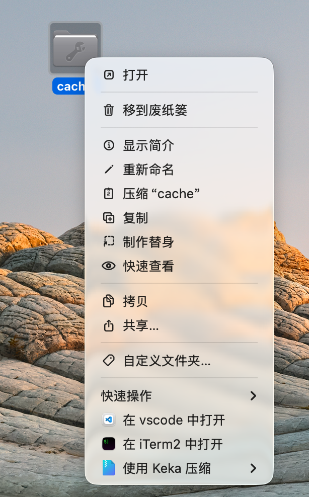
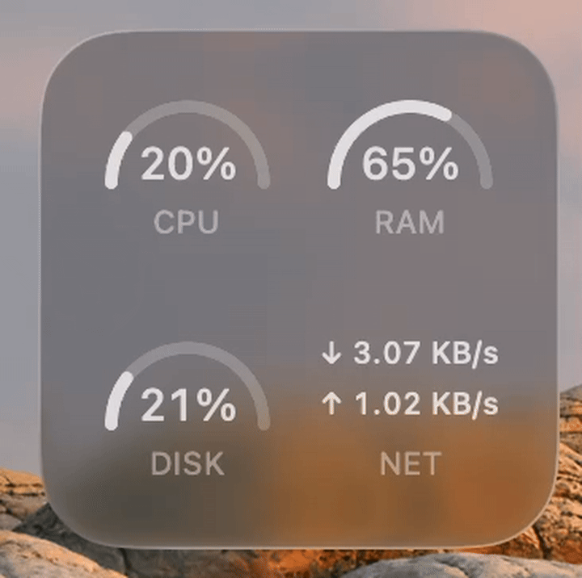

# MikuTools

自用 macOS 小工具，沿用 mikuai 品牌，与「初研 AI」同系列。支持 macOS 14 及以上。

## Finder 右键菜单

- **在 vscode 中打开**：打开选中的文件或文件夹，支持多选；右键空白区域时打开当前目录。
- **在 iTerm2 中打开**：在选中文件的所在目录、选中的文件夹或当前目录中新建终端窗口。

两个菜单项直接显示在 Finder 右键菜单中，并使用本机已安装应用的图标。

## 系统监控小组件

原生 macOS 小组件，可添加到桌面和通知中心，显示：

- **CPU**：整体 CPU 使用率。
- **RAM**：内存使用率。
- **DISK**：系统盘空间使用率。
- **NET**：主要网络接口的下载和上传速度，自动切换 B/s、KB/s、MB/s、GB/s。

支持小型 2×2 和中型 1×4 布局，采用深色背景、白色圆弧和数字。

主 App 在后台持续采集数据：CPU、内存和网络每秒更新，磁盘每 15 秒更新。小组件的实际刷新由 macOS 调度；主 App 退出后保留最后一次数据。

